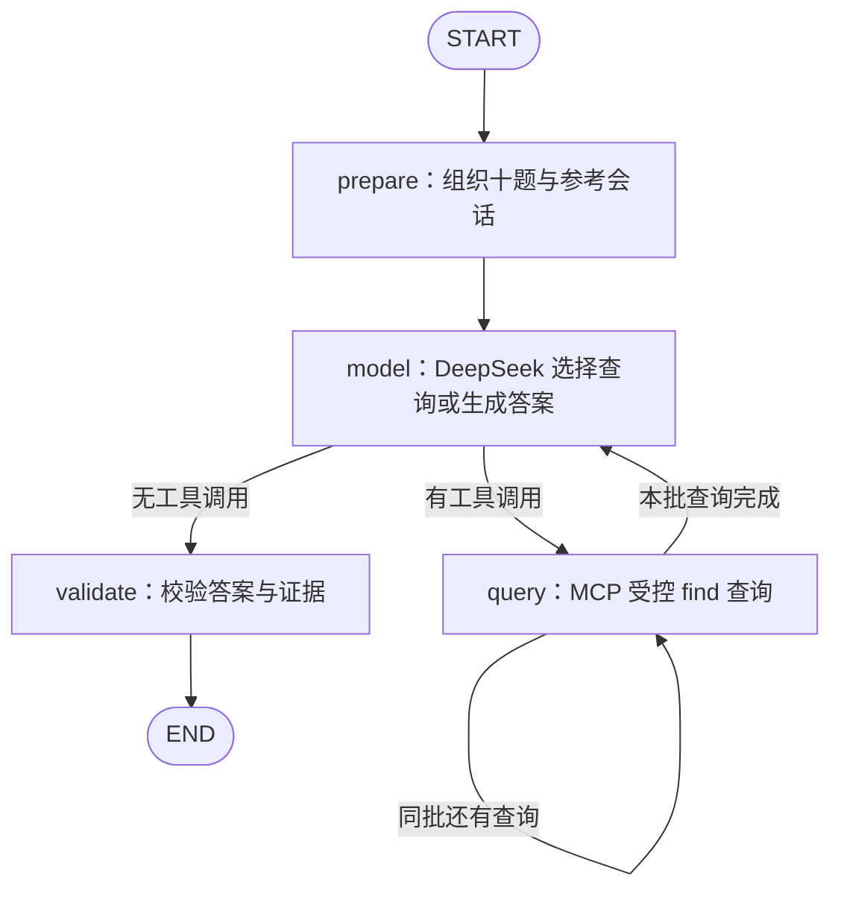

# F1AP Agent

F1 Predict 的 Python 预测执行端，与 [F1AP API](https://github.com/xiaob1n/f1ap-api) 通过 RabbitMQ 协作。Agent 消费预测任务，使用 LangGraph、DeepSeek 和 MongoDB MCP 查询历史参考数据，生成十题答案建议，再将结果交给 API 入库。

Agent 不直接写业务 MySQL，也不向 F1 官网提交答案。当前答案协议为 `ANSWERS_V2`，输出选项、解释、证据引用和数据不足状态，不计算竞猜积分。

## V1 任务运行时已退役

正式入口 `f1ap-agent-mq` 仅解析 V2 `ResearchTask`，由独立的 `ResearchRuntime` 执行，不再接入旧 `Worker`。旧任务消息拒收且不重新入队；`f1ap.v1` exchange 和 `f1ap.agent.tasks.v1` 队列仅为兼容命名。旧 Worker 内部库与合成夹具辅助仍可能保留，不能据此认为正式入口仍支持 V1。

- `python -m f1ap_agent.worker` 不再执行任务，返回 `LEGACY_V1_TASKS_RETIRED`、退出码 2（`--help` 除外）。
- 正式 MQ CLI 已移除 `--mapping`、`--llm-config`、`--mock-plan`、`--news-catalog`、`--mock-revisions`、`--mock-scenario`、`--reconcile-usage`，不要沿用旧 mock 或补价命令。
- `--existing-topology` 保留；无论是否传入，连接始终被动检查既有拓扑，不声明 exchange/queue，也不绑定。共享拓扑未改动。
- Nacos schema 暂保持向后兼容：旧 `model`、mapping 字段仍会解析校验，但正式 MQ 不再使用它们执行任务；不要因 CLI 参数移除就直接删除配置中的这些字段。独立 `f1ap-mongo-research` 的本地 `--config` 仍保留。

Store 单写锁和 V2 持久化恢复边界不变，历史状态不自动清理、迁移或重跑。本次源码退役尚不代表已部署，旧运行实例不会自动更新；构建和运行验证须以实际记录为准。旧 [E10 运维手册](docs/runbook.md) 主体仅供历史参考，不能作为当前 V1/mock 恢复步骤。

## 预测链路

```text
调度器 → 同步当前分站题目 → API 创建预测任务
       → RabbitMQ → Agent → LangGraph → 完成事件 → API 写库
```

取题与预测分开执行：单独同步题目不会调用模型；调度器提交预测请求后才可能触发真实模型调用。当前研究图在 `src/f1ap_agent/mongo_research/graph.py` 中定义：



十题共用一次研究循环。查询限定参考会话、字段、返回条数和字节数；有事件时间的集合还受截止时间过滤。模型可查询会话、车手、单圈、进站、天气、赛会指令和轮胎段，不能任意执行数据库命令。

最终答案必须覆盖十题，选项必须来自本题定义。证据不足时返回 `DATA_INSUFFICIENT`，不编造选项映射。参考会话不是目标分站事实；事件截止时间也不保证历史时点已经能获取这些数据。

## 技术栈与目录

- Python 3.12、uv、aio-pika、httpx、LangGraph 1.0.3。
- DeepSeek `deepseek-flash`，MongoDB MCP 使用只读 stdio 子进程。
- Docker 镜像包含 Node.js 22 和 `mongodb-mcp-server@3.3.0`。

| 路径 | 内容 |
| --- | --- |
| `src/f1ap_agent/messaging/` | MQ 消费、确认和健康状态 |
| `src/f1ap_agent/mongo_research/` | 四节点研究图、查询约束、模型与 V2 适配 |
| `src/f1ap_agent/contracts/` | 契约与语义校验 |
| `src/f1ap_agent/nacos.py` | 启动配置加载 |
| `src/f1ap_agent/question_sync.py` | 当前分站题目同步 |
| `src/f1ap_agent/hourly_prediction.py` | 北京时间定时调度 |
| `config/` | 配置示例及容器调度配置 |
| `contracts.lock.json` | 锁定 API 冻结契约 |

部分同步脚本、配置和文档曾仅作为本机补充，干净克隆是否包含它们应以实际检出文件为准。历史项目描述与阶段报告不是当前运行状态的证明。

## 安装与配置

在仓库根目录使用 Python 3.12 安装锁定依赖：

```bash
uv sync --frozen --no-dev
```

正式 MQ Worker 需要完整的 API `contracts/v1` 及匹配的锁文件、既有 RabbitMQ 拓扑和持久化 runtime/output 目录。启用研究还需要 MongoDB MCP 可执行程序、只读数据连接以及模型密钥。容器构建需将 API 的 `contracts/v1` 暂存到 Agent 构建上下文；该目录不是本仓独立维护的第二份协议。

Nacos 引导通过环境注入，不自动加载 `.env`：

| 环境变量 | 用途 |
| --- | --- |
| `F1AP_NACOS_SERVER_ADDR` | 配置中心地址 |
| `F1AP_NACOS_NAMESPACE` | Namespace ID；public 显式设为空字符串 |
| `F1AP_NACOS_GROUP` | 配置分组，例如 `DEFAULT_GROUP` |
| `F1AP_NACOS_DATA_ID` | Agent 配置名，例如 `f1ap-agent.toml` |
| `F1AP_NACOS_USERNAME` / `F1AP_NACOS_PASSWORD` | 私有认证信息 |
| `F1AP_CONTRACTS_DIR` / `F1AP_CONTRACTS_LOCK` | 冻结契约与锁文件路径 |

参考 [Nacos 配置说明](docs/nacos.md) 和 [Agent 配置模板](config/nacos-agent.example.toml)。启动时读取一次配置，修改 Nacos 后需重启进程。凭据只能放在环境变量或私有文件中，不放入 Git、命令行、任务正文或日志。

配置已注入并授权连接 Nacos 后，可检查配置：

```bash
.venv/bin/f1ap-agent-mq --check-config
```

该检查会访问 Nacos，但不连接 MQ/MongoDB 或调用模型。离线查看参数可使用 `--help`。

## 运行入口

### MQ Worker

在 API、现有消息拓扑、配置与目录准备完成且已获真实运行授权后启动：

```bash
.venv/bin/f1ap-agent-mq --run --daemon --ensure-runtime --existing-topology \
  --runtime-dir /data/runtime --output /data/output
```

运行用户必须有目录写权限。同一个 runtime 只允许一个写入进程；Agent 不声明 MQ 拓扑。订阅健康检查只读本地状态：

```bash
.venv/bin/f1ap-agent-mq --healthcheck --require-ready --runtime-dir /data/runtime
```

健康表示消费者状态正常，不代表已经生成有效预测。请结合具体请求、结果和模型/查询回执判断任务是否成功。

### 定时预测

预先提供内部 API 令牌 `F1AP_INTERNAL_WRITE_TOKEN`，或用 `F1AP_INTERNAL_WRITE_TOKEN_FILE` 指定私有令牌文件；两者不要同时设置。

```bash
.venv/bin/python -m f1ap_agent.hourly_prediction \
  --config config/hourly-prediction.toml
```

当前实现按北京时间周一至周四 00:00、12:00 执行，周五至周六每两小时执行，周日不执行。只允许计划整点后一分钟内运行，其余时刻等待下个窗口。

**`--once` 是单次检查，不是强制补跑。** 非窗口期返回 `WAITING_SCHEDULE`，不会取题或写库。调度失败不立即重试；更换参考会话需修改配置并重启。文件名包含 `hourly` 不表示当前每小时运行。

### 单独同步题目

仅在授权官网采集、API 同步入口可用、对应配置文件存在时执行：

```bash
.venv/bin/f1ap-question-sync --config config/question-sync.toml --once
```

此 CLI 仅接受本机 HTTP API 地址，使用环境变量 `F1AP_INTERNAL_WRITE_TOKEN`；它不像调度器那样支持令牌文件或 `http://api:8080`。不要直接照搬容器调度配置给它。

同步状态为 `IMPORTED`、`UNCHANGED`、`SKIPPED_PROTECTED_ROUND` 或 `FAILED`。同步依赖 API 的 `/internal/v1/round-syncs`；当前源码已由 `RoundImportController` 提供该入口，受 `f1ap.e03.enabled` 门控并需内部令牌。执行前仍须核对部署版本、配置和授权。同步本身不创建预测请求，也不触发旧 V1 任务。

### 独立研究

`f1ap-mongo-research` 支持明确指定研究问题、参考会话、截止时间、十题定义和新的输出目录。查看完整参数：

```bash
.venv/bin/f1ap-mongo-research --help
```

实际研究需要 `--authorize-model` 和当次模型调用授权。配置示例见 [mongo-research.example.toml](config/mongo-research.example.toml)。Nacos 模式与本地 `--config` 不可混用。

## 结果与可靠性

- 查询和模型调用生成独立回执；研究结果写入 `answer.json`，有十题定义时另写 `predictions.json`。
- MQ 运行记录保存在 runtime 的 `unscored/records.json` 中，状态依次为 `REGISTERED → INTENT → COMPLETED`，发送确认后另记 `confirmed` 标记。
- 付费研究开始后崩溃不自动重做调用；完成事件先落盘，再可靠发送，API 幂等消费。
- 原始数据库内容和 MCP 子进程不接收无关服务凭据；传输失败不自动重试模型调用。

## 验证与范围

```bash
.venv/bin/f1ap-contract-verify --help
.venv/bin/python -m unittest discover -s tests -v
```

测试目录可能未被 Git 跟踪；没有测试文件或发现零个测试不等于通过业务验收。macOS 运行测试时可设置 `TMPDIR=/private/tmp`。本地、模拟、静态检查与真实服务验证应分开记录，历史测试数量不作为当前保证。

新闻 RAG、真实 Embedding、Chroma 向量检索不属于当前交付能力。模型研究结果是无积分建议，不保证准确率，也不代表冻结 V1 契约下的正式 VALID/LIVE 预测。

配套协议与接口见 [API 仓库](https://github.com/xiaob1n/f1ap-api) 的 `contracts/v2/README.md`。运行真实采集、模型请求、共享拓扑或部署前，应确认当次授权范围。
